## 👋 Hello! I'm Ching (Jason) Chang, Ph.D. 

I am a **Staff ML Research Scientist @ [Pravāh](https://pravah.com/)**, where I lead the load forecasting models behind its production platform ([load.pravah.com](https://load.pravah.com)), delivering electricity demand forecasts for all seven major U.S. grid operators (CAISO, ERCOT, ISO-NE, MISO, NYISO, PJM, SPP). I led the development of [Banyan](https://www.pravah.com/blog/banyan), our model for electricity demand forecasting: in a year-long benchmark against 10 other approaches, including fine-tuned time-series foundation models, it had the lowest error in 77 of 87 U.S. grid areas. I received my Ph.D. in Computer Science from National Yang Ming Chiao Tung University (NYCU), Taiwan, where I was advised by [Prof. Wen-Chih Peng](https://sites.google.com/site/wcpeng/). Previously, I was a Visiting Graduate Researcher in Computer Science at UCLA, working with [Prof. Wei Wang](http://web.cs.ucla.edu/~weiwang/).  

My research focuses on **Time Series Analysis**, **Large Foundation Models**, **Causal Discovery**, and **Multimodal Reasoning**.  
I have published multiple papers in top AI and data science conferences (NeurIPS, AAAI, CIKM, ICDE) and journals (ACM TIST). I also serve as a reviewer for top-tier venues in the field.

## 🤝 Let's Connect

If you’re interested in collaboration, feel free to contact me:

- 📬 **Email**: [blacksnail789521@gmail.com](mailto:blacksnail789521@gmail.com)  
- 🌐 **Website**: [blacksnail789521.github.io](https://blacksnail789521.github.io/)
- 💼 **LinkedIn**: [Ching (Jason) Chang](https://www.linkedin.com/in/ching-chang/)
- 📄 **Resume**: [View PDF](https://blacksnail789521.github.io/resume/Ching%20Chang_Resume.pdf)
- 🎓 **Google Scholar**: [Profile](https://scholar.google.com.tw/citations?user=OXCVj48AAAAJ)

## 📊 GitHub Stats

